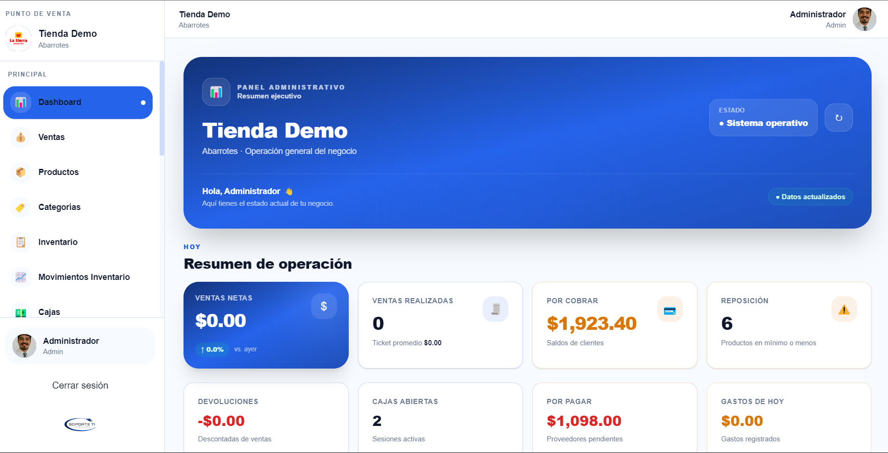
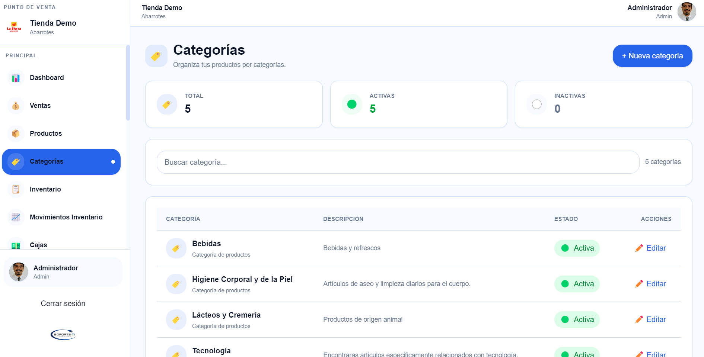
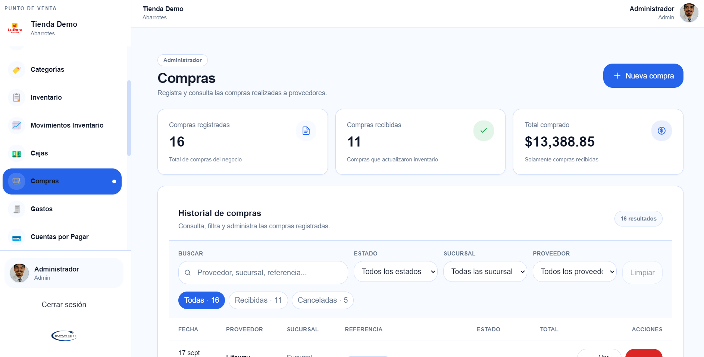
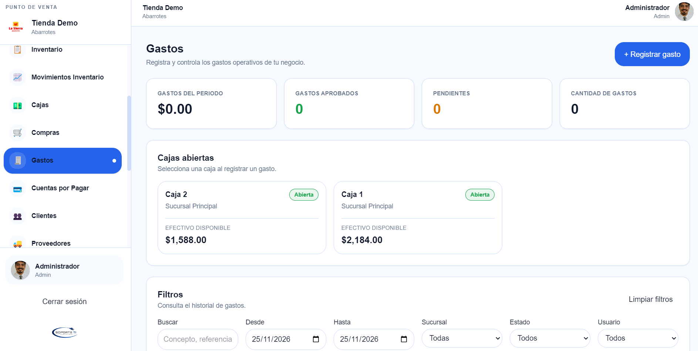
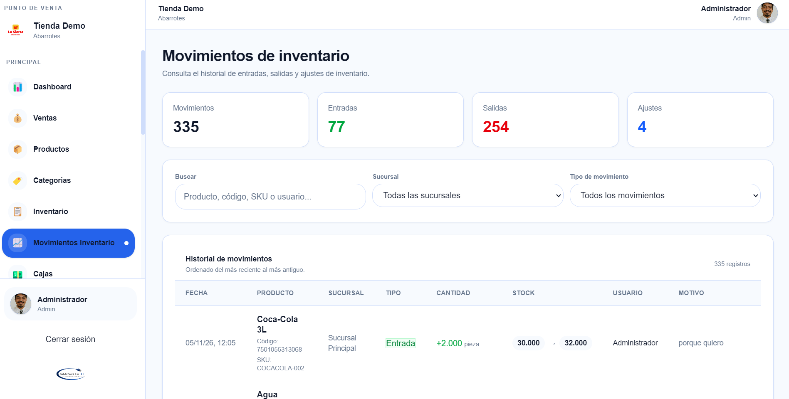
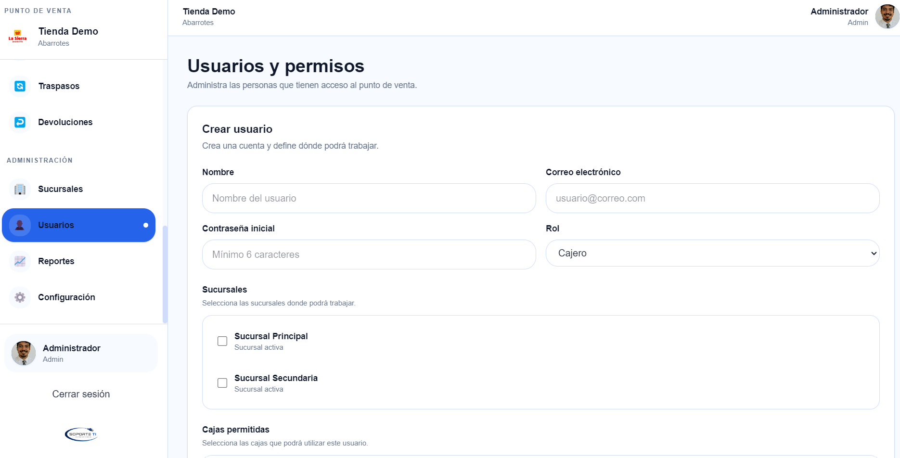
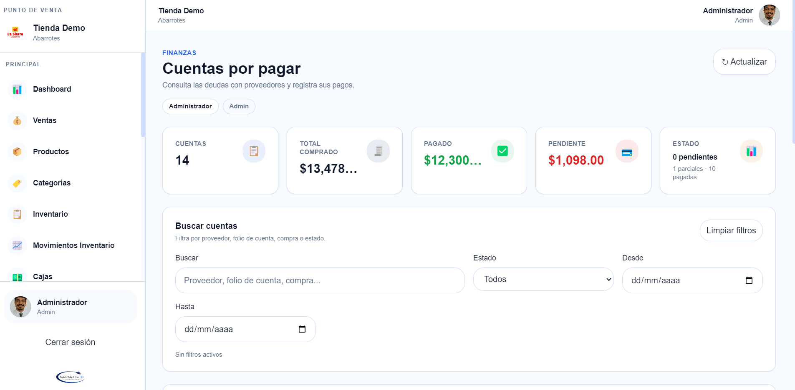
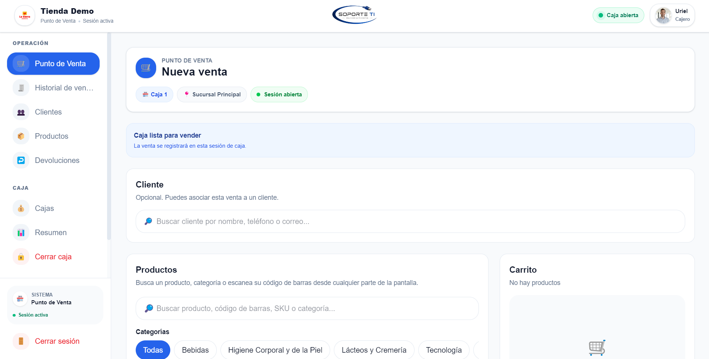
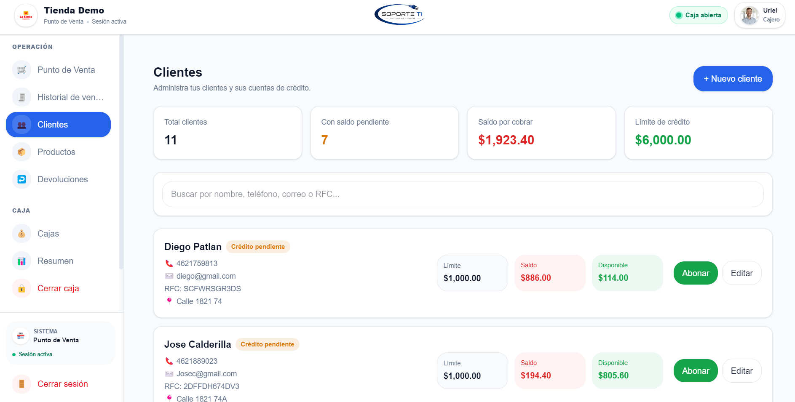
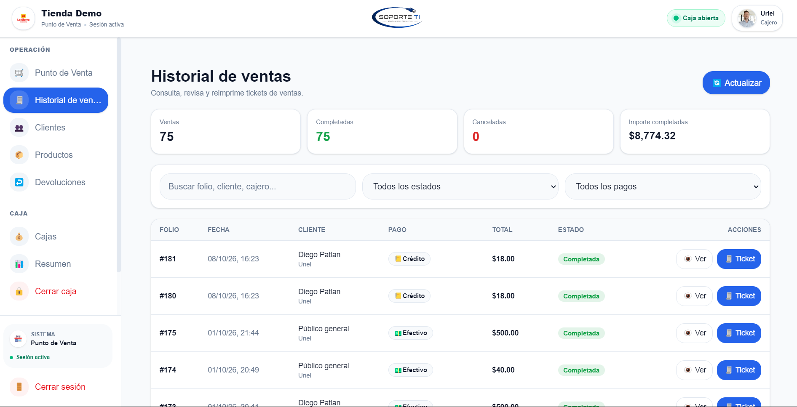

# 🛒 Sistema de Punto de Venta Multi-Negocios — Soporte IT

Sistema de punto de venta desarrollado para facilitar la administración y operación de negocios mediante herramientas de gestión comercial, control de inventario y seguimiento de operaciones.

La plataforma cuenta con un panel administrativo y un módulo de Punto de Venta (POS), con interfaces adaptables a diferentes dispositivos.

🌐 **Aplicación web:** https://punto-de-ventasit.vercel.app/admin/login

---

## 🚀 Características principales

- Gestión de productos, categorías y proveedores.
- Registro y administración de ventas y compras.
- Control de inventario y movimientos de mercancía.
- Administración de clientes y ventas a crédito.
- Gestión de cajas y movimientos de efectivo.
- Administración de usuarios y roles.
- Control de sucursales y traspasos.
- Gestión de devoluciones y gastos.
- Configuración fiscal e impuestos.
- Consulta de reportes y cuentas por pagar.
- Configuración de impresoras para tickets de compra.
- Personalización de la apariencia del sistema.

## 🏗️ Arquitectura del sistema

El proyecto utiliza una arquitectura web basada en Next.js y Supabase, separando la interfaz de usuario de los servicios de autenticación y almacenamiento de información.

**Componentes principales:**

- **Frontend:** Next.js, React y TypeScript.
- **Backend y servicios:** Supabase.
- **Base de datos:** PostgreSQL.
- **Autenticación:** Supabase Auth.
- **Control de acceso:** Roles y permisos de usuario.
- **Despliegue:** Vercel.

El sistema está organizado en dos módulos principales:

- **Panel de Administración:** permite gestionar y supervisar las operaciones del negocio.
- **Punto de Venta (POS):** permite realizar ventas y administrar las operaciones cotidianas de caja.

La aplicación contempla la separación de información por negocio y el control de acceso a los datos mediante mecanismos de seguridad de Supabase.

## 🛠️ Tecnologías utilizadas

### Frontend

<table>
  <tr>
    <td align="center" width="120">
       
      <b>Next.js</b>
    </td>
    <td align="center" width="120">
       
      <b>React</b>
    </td>
    <td align="center" width="120">
       
      <b>TypeScript</b>
    </td>
    <td align="center" width="120">
       
      <b>JavaScript</b>
    </td>
    <td align="center" width="120">
       
      <b>Tailwind CSS</b>
    </td>
  </tr>
</table>

### Backend y base de datos

<table>
  <tr>
    <td align="center" width="120">
       
      <b>Supabase</b>
    </td>
    <td align="center" width="120">
       
      <b>PostgreSQL</b>
    </td>
  </tr>
</table>

### Herramientas y despliegue

<table>
  <tr>
    <td align="center" width="120">
       
      <b>Git</b>
    </td>
    <td align="center" width="120">
       
      <b>GitHub</b>
    </td>
    <td align="center" width="120">
       
      <b>Vercel</b>
    </td>
  </tr>
</table>

### Librerías

- ExcelJS
- XLSX

## 🎯 Objetivo del proyecto

Desarrollar una plataforma que permita administrar las principales operaciones de un negocio desde una interfaz intuitiva, adaptable y fácil de utilizar, integrando herramientas de gestión comercial, inventario, ventas y administración.

## 👨‍💻 Desarrollador

Proyecto desarrollado como iniciativa personal para aplicar y fortalecer conocimientos en desarrollo de software, diseño de interfaces, integración de servicios backend y gestión de bases de datos.

---

## 🔐 Accesos de demostración

La aplicación cuenta con dos módulos independientes:

**🛡️ Panel de Administración**

https://punto-ventasit.vercel.app/admin/login

Permite explorar las herramientas de administración y configuración del negocio.

**🛒 Punto de Venta (POS)**

https://punto-ventasit.vercel.app/pos/login

Permite explorar las funciones de venta, clientes, productos y operaciones de caja.

> **Nota:** Los accesos de demostración se pueden solicitar directamente al desarrollador.

---

# 🖥️ Panel de Administración

El panel administrativo permite gestionar y supervisar las diferentes operaciones del negocio desde una plataforma centralizada.

## 🔐 Acceso al sistema

<table>
  <tr>
    <td align="center">
      
       <b>Inicio de sesión administrativo</b>
    </td>
    <td align="center">
      
       <b>Dashboard principal</b>
    </td>
  </tr>
</table>

## 📦 Gestión comercial

Administración del catálogo de productos, categorías, clientes y proveedores.

<table>
  <tr>
    <td align="center">
      
       <b>Productos</b>
    </td>
    <td align="center">
      
       <b>Categorías</b>
    </td>
  </tr>
  <tr>
    <td align="center">
      
       <b>Clientes</b>
    </td>
    <td align="center">
      
       <b>Proveedores</b>
    </td>
  </tr>
</table>

## 💰 Operaciones comerciales

Módulos para administrar las operaciones de venta, compras, devoluciones y gastos.

<table>
  <tr>
    <td align="center">
      
       <b>Ventas</b>
    </td>
    <td align="center">
      
       <b>Compras</b>
    </td>
  </tr>
  <tr>
    <td align="center">
      
       <b>Devoluciones</b>
    </td>
    <td align="center">
      
       <b>Gastos</b>
    </td>
  </tr>
</table>

## 📋 Control de inventario

Herramientas para consultar existencias, registrar movimientos y gestionar traspasos de mercancía.

<table>
  <tr>
    <td align="center">
      
       <b>Inventario</b>
    </td>
    <td align="center">
      
       <b>Movimientos de inventario</b>
    </td>
  </tr>
  <tr>
    <td align="center" colspan="2">
      
       <b>Traspasos</b>
    </td>
  </tr>
</table>

## 🏢 Administración del negocio

Gestión de cajas, sucursales y usuarios del sistema.

<table>
  <tr>
    <td align="center">
      
       <b>Cajas</b>
    </td>
    <td align="center">
      
       <b>Sucursales</b>
    </td>
  </tr>
  <tr>
    <td align="center" colspan="2">
      
       <b>Usuarios y roles</b>
    </td>
  </tr>
</table>

## 📈 Finanzas y reportes

Consulta y seguimiento de información financiera y operativa.

<table>
  <tr>
    <td align="center">
      
       <b>Cuentas por pagar</b>
    </td>
    <td align="center">
      
       <b>Reportes</b>
    </td>
  </tr>
</table>

## ⚙️ Configuración del sistema

El sistema incluye opciones para adaptar diferentes parámetros de funcionamiento del negocio:

- Configuración fiscal e impuestos.
- Integración y configuración de terminales de Mercado Pago.
- Personalización de la apariencia e identidad visual del negocio.

<table>
  <tr>
    <td align="center">
      
       <b>Configuración del sistema</b>
    </td>
  </tr>
</table>

---

# 🛒 Punto de Venta (POS)

Módulo diseñado para realizar las operaciones comerciales del negocio, permitiendo gestionar ventas, clientes, productos y movimientos de caja desde una interfaz intuitiva.

## 🔐 Acceso al sistema

<table>
  <tr>
    <td align="center">
      
       <b>Inicio de sesión POS</b>
    </td>
    <td align="center">
      
       <b>Pantalla principal de ventas</b>
    </td>
  </tr>
</table>

## 📦 Productos y clientes

Consulta de productos disponibles y administración de clientes del negocio.

<table>
  <tr>
    <td align="center">
      
       <b>Productos</b>
    </td>
    <td align="center">
      
       <b>Clientes y crédito</b>
    </td>
  </tr>
</table>

El módulo de clientes permite registrar nuevos clientes, consultar su información y gestionar aquellos que realizan compras mediante crédito.

## 🧾 Historial de ventas y devoluciones

Consulta de las ventas realizadas y gestión de devoluciones de productos.

<table>
  <tr>
    <td align="center">
      
       <b>Historial de ventas</b>
    </td>
    <td align="center">
      
       <b>Devoluciones</b>
    </td>
  </tr>
</table>

## 💵 Gestión de caja

Herramientas para supervisar las operaciones y movimientos relacionados con la caja.

<table>
  <tr>
    <td align="center">
      
       <b>Información y movimientos</b>
    </td>
    <td align="center">
      
       <b>Resumen de caja</b>
    </td>
  </tr>
  <tr>
    <td align="center" colspan="2">
      
       <b>Cierre de caja</b>
    </td>
  </tr>
</table>

## ⚙️ Configuración del POS

El módulo cuenta con opciones para adaptar el funcionamiento y la apariencia de la interfaz.

Entre sus funcionalidades se encuentran:

- Configuración de impresoras para la impresión de tickets de compra.
- Personalización de la apariencia de la interfaz.
- Configuración de opciones del punto de venta.

<table>
  <tr>
    <td align="center">
      
       <b>Configuración del POS</b>
    </td>
  </tr>
</table>

---

## 🖥️ Versión de escritorio

Se contempla una versión de escritorio desarrollada con **Tauri**, actualmente en desarrollo.

## 📌 Estado del proyecto

La aplicación web se encuentra desplegada y disponible para demostración.

La versión de escritorio continúa en desarrollo.
