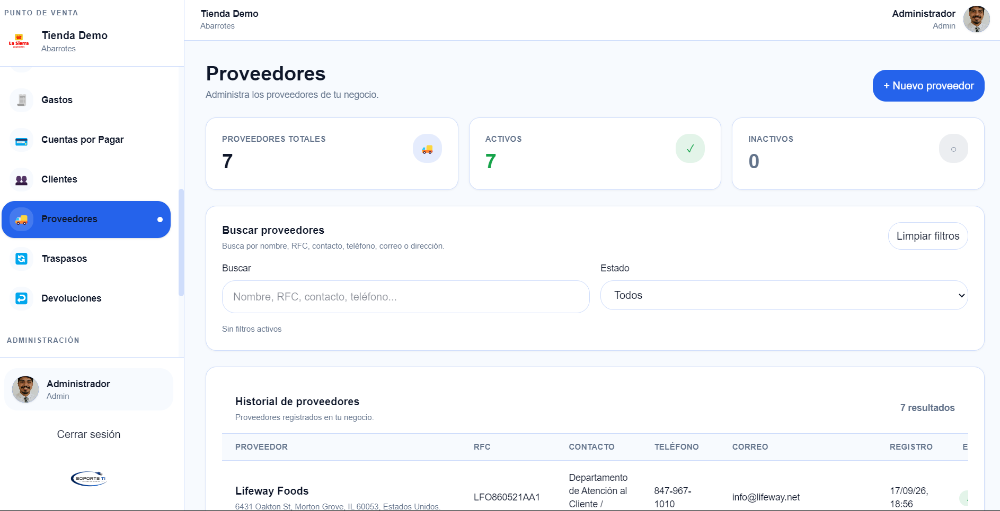
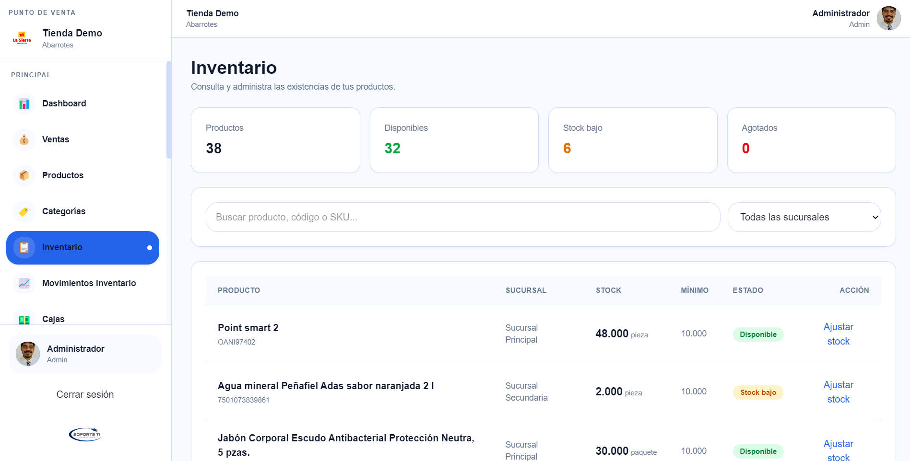
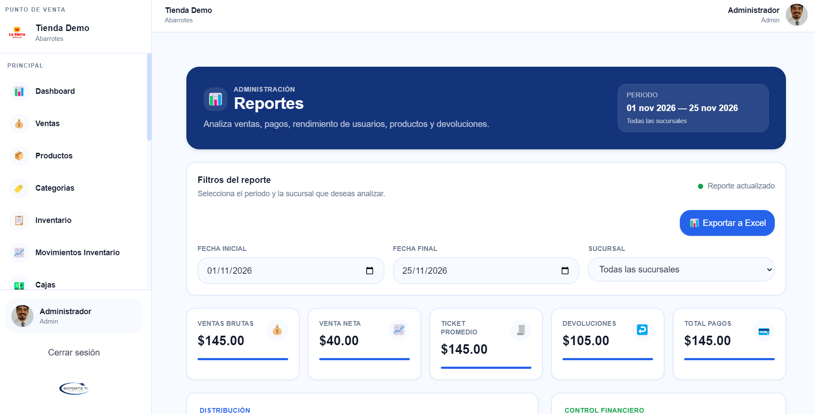
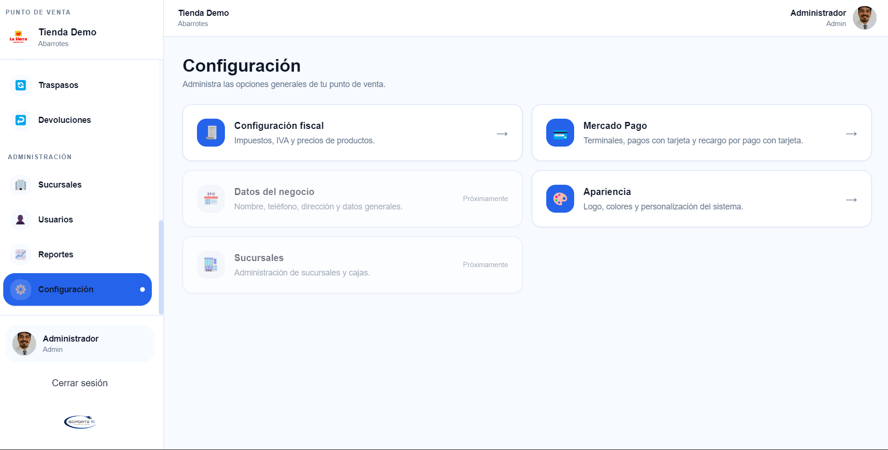
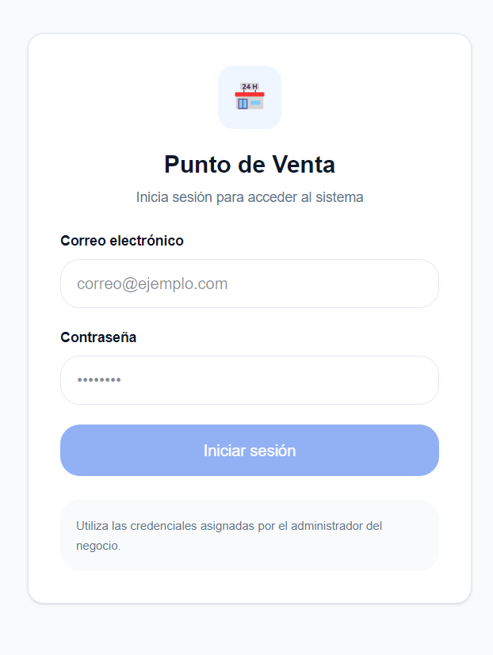
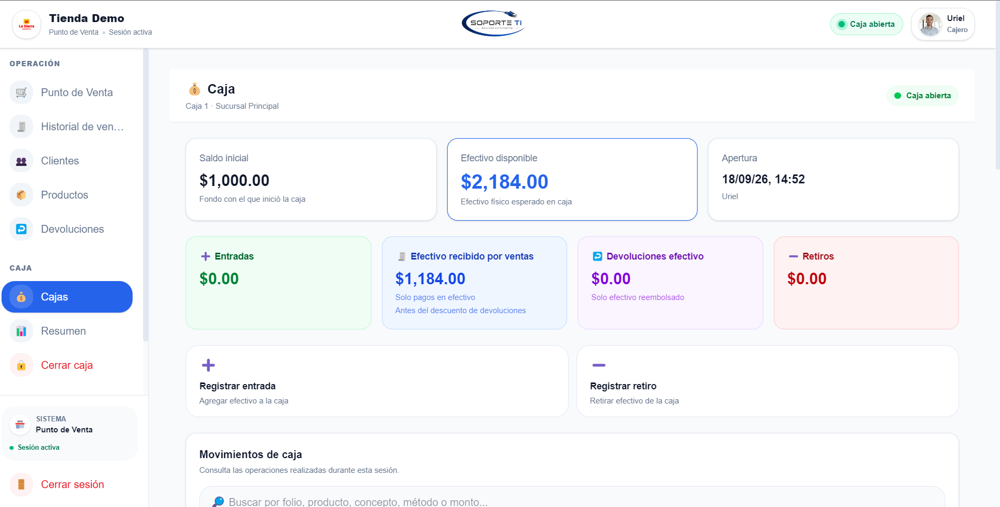
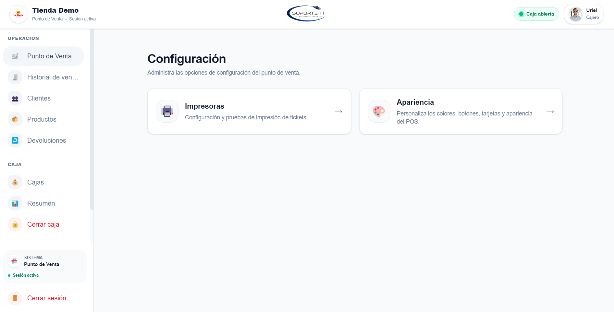

<div align="center">

# 🛒 Punto de Venta Multi-Negocios

### Plataforma web de gestión comercial | Soporte IT

Sistema integral para la administración de negocios, diseñado para centralizar operaciones comerciales, inventario, ventas y gestión administrativa desde una sola plataforma.

<br>

[**Panel administrativo**](https://punto-ventasit.vercel.app/admin/login) ·
[**Punto de Venta**](https://punto-ventasit.vercel.app/pos/login)

<br>


</div>

---

## 01 · Acerca del proyecto

Punto de Venta Multi-Negocios es una aplicación web desarrollada para facilitar la administración y operación de diferentes establecimientos.

Integra herramientas de gestión comercial, control de inventario, seguimiento financiero y operaciones de caja, mediante dos módulos principales:

| Módulo | Descripción |
|:---|:---|
| **Panel de Administración** | Gestión centralizada de las operaciones, configuración y supervisión del negocio. |
| **Punto de Venta (POS)** | Interfaz para realizar ventas y gestionar las operaciones cotidianas de caja. |

### Funcionalidades principales

- Gestión de productos, categorías y proveedores.
- Registro y administración de ventas y compras.
- Control de inventario y movimientos de mercancía.
- Administración de clientes y ventas a crédito.
- Gestión de cajas y movimientos de efectivo.
- Administración de usuarios y roles.
- Control de sucursales y traspasos.
- Gestión de devoluciones y gastos.
- Configuración fiscal e impuestos.
- Consulta de reportes y cuentas por pagar.
- Configuración de impresoras para tickets.
- Personalización de la apariencia del sistema.

---

## 02 · Tecnologías

Tecnologías y herramientas utilizadas durante el desarrollo.

### Frontend

<p align="center">
  
</p>

<p align="center">
  <sub>Next.js · React · TypeScript · JavaScript · Tailwind CSS</sub>
</p>

### Backend y base de datos

<p align="center">
  
</p>

<p align="center">
  <sub>Supabase · PostgreSQL</sub>
</p>

### Herramientas y despliegue

<p align="center">
  
</p>

<p align="center">
  <sub>Git · GitHub · Vercel</sub>
</p>

**Librerías adicionales:** ExcelJS y XLSX.

---

## 03 · Arquitectura del sistema

La aplicación utiliza Next.js como framework principal y Supabase para los servicios backend, autenticación y almacenamiento de información.

```text
                 USUARIO
                    │
                    ▼
          ┌──────────────────┐
          │    NEXT.JS       │
          │  Aplicación Web  │
          └──────────────────┘
                    │
          ┌─────────┴─────────┐
          ▼                   ▼
  ┌──────────────┐    ┌──────────────┐
  │   PANEL      │    │     POS      │
  │ ADMINISTRATIVO│   │ Punto de Venta│
  └──────────────┘    └──────────────┘
          │                   │
          └─────────┬─────────┘
                    ▼
          ┌──────────────────┐
          │     SUPABASE     │
          │ Auth y servicios │
          └──────────────────┘
                    │
                    ▼
          ┌──────────────────┐
          │   POSTGRESQL     │
          │   Base de datos  │
          └──────────────────┘
```

**Componentes principales:**

- Frontend: Next.js, React y TypeScript.
- Backend y servicios: Supabase.
- Base de datos: PostgreSQL.
- Autenticación: Supabase Auth.
- Control de acceso: roles y permisos de usuario.
- Despliegue: Vercel.

La aplicación contempla la separación de información por negocio y mecanismos de seguridad mediante Supabase.


## 🔐 Accesos de demostración

Puedes explorar los dos módulos de la plataforma utilizando cuentas de prueba.

<table>
  <tr>
    <td align="center" width="50%">
      <h3>🖥️ Panel administrativo</h3>
      <p>Acceso a las herramientas de administración y configuración del negocio.</p>
      <a href="https://punto-ventasit.vercel.app/admin/login">
        <strong>ABRIR PANEL ADMINISTRATIVO ↗</strong>
      </a>
      <br><br>
      <b>Correo:</b><br>
      admin@tiendademo.com
      <br><br>
      <b>Contraseña:</b><br>
      Admin123
    </td>
    <td align="center" width="50%">
      <h3>🛒 Punto de Venta (POS)</h3>
      <p>Acceso al módulo de ventas, clientes, productos y operaciones de caja.</p>
      <a href="https://punto-ventasit.vercel.app/pos/login">
        <strong>ABRIR PUNTO DE VENTA ↗</strong>
      </a>
      <br><br>
      <b>Correo:</b><br>
      salaspatlandiego@gmail.com
      <br><br>
      <b>Contraseña:</b><br>
      Uriel123
    </td>
  </tr>
</table>

> **Nota:** Las cuentas son exclusivamente para demostración. Se recomienda utilizar usuarios independientes, con información de prueba y permisos limitados.


---

## 04 · Panel de Administración

Módulo orientado a la gestión centralizada de las operaciones comerciales y administrativas del negocio.

### Acceso y dashboard

<p align="center">
  <a href="screenshots/loginadmin.png">
    
  </a>
  <br>
  <sub><b>01. Inicio de sesión</b></sub>
</p>

<p align="center">
  <a href="screenshots/dashboardadmin.png">
    
  </a>
  <br>
  <sub><b>02. Dashboard general</b></sub>
</p>

### Gestión comercial

Administración de los elementos principales del catálogo y de las relaciones comerciales.

<table>
  <tr>
    <td width="50%" align="center">
      <a href="screenshots/productosadmin.png">
        
      </a>
      <br><b>Productos</b>
    </td>
    <td width="50%" align="center">
      <a href="screenshots/categoriasadmin.png">
        
      </a>
      <br><b>Categorías</b>
    </td>
  </tr>
  <tr>
    <td width="50%" align="center">
      <a href="screenshots/clientesadmin.png">
        
      </a>
      <br><b>Clientes</b>
    </td>
    <td width="50%" align="center">
      <a href="screenshots/proveedoresadmin.png">
        
      </a>
      <br><b>Proveedores</b>
    </td>
  </tr>
</table>

### Operaciones comerciales

Módulos para el seguimiento y administración de las operaciones del negocio.

<table>
  <tr>
    <td width="50%" align="center">
      <a href="screenshots/ventasadmin.png">
        
      </a>
      <br><b>Ventas</b>
    </td>
    <td width="50%" align="center">
      <a href="screenshots/comprasadmin.png">
        
      </a>
      <br><b>Compras</b>
    </td>
  </tr>
  <tr>
    <td width="50%" align="center">
      <a href="screenshots/devolucionesadmin.png">
        
      </a>
      <br><b>Devoluciones</b>
    </td>
    <td width="50%" align="center">
      <a href="screenshots/gastosadmin.png">
        
      </a>
      <br><b>Gastos</b>
    </td>
  </tr>
</table>

### Inventario y logística

Consulta de existencias, seguimiento de movimientos y gestión de traspasos de mercancía.

<table>
  <tr>
    <td width="50%" align="center">
      <a href="screenshots/inventarioadmin.png">
        
      </a>
      <br><b>Inventario</b>
    </td>
    <td width="50%" align="center">
      <a href="screenshots/movimientosinventarioadmin.png">
        
      </a>
      <br><b>Movimientos de inventario</b>
    </td>
  </tr>
  <tr>
    <td colspan="2" align="center">
      <a href="screenshots/transpasosadmin.png">
        
      </a>
      <br><b>Traspasos</b>
    </td>
  </tr>
</table>

### Administración del negocio

Control de cajas, sucursales y usuarios con acceso al sistema.

<table>
  <tr>
    <td width="50%" align="center">
      <a href="screenshots/cajasadmin.png">
        
      </a>
      <br><b>Cajas</b>
    </td>
    <td width="50%" align="center">
      <a href="screenshots/sucursalesadmin.png">
        
      </a>
      <br><b>Sucursales</b>
    </td>
  </tr>
  <tr>
    <td colspan="2" align="center">
      <a href="screenshots/usuariosadmin.png">
        
      </a>
      <br><b>Usuarios y roles</b>
    </td>
  </tr>
</table>

### Finanzas y reportes

Herramientas para consultar información financiera y operativa.

<table>
  <tr>
    <td width="50%" align="center">
      <a href="screenshots/cuentasporpagaradmin.png">
        
      </a>
      <br><b>Cuentas por pagar</b>
    </td>
    <td width="50%" align="center">
      <a href="screenshots/reportesadmin.png">
        
      </a>
      <br><b>Reportes</b>
    </td>
  </tr>
</table>

### Configuración

Opciones para adaptar parámetros de funcionamiento y presentación del negocio.

- Configuración fiscal e impuestos.
- Integración y configuración de terminales de Mercado Pago.
- Personalización de la apariencia e identidad visual.

<p align="center">
  <a href="screenshots/configuracionadmin.png">
    
  </a>
  <br>
  <sub><b>Configuración general del negocio</b></sub>
</p>

---

## 05 · Punto de Venta (POS)

Módulo diseñado para las operaciones cotidianas de venta, atención a clientes y administración de caja.

### Acceso y pantalla de ventas

<p align="center">
  <a href="screenshots/loginpos.png">
    
  </a>
  <br>
  <sub><b>01. Acceso al punto de venta</b></sub>
</p>

<p align="center">
  <a href="screenshots/puntodeventapos.png">
    
  </a>
  <br>
  <sub><b>02. Pantalla principal de ventas</b></sub>
</p>

### Productos y clientes

<table>
  <tr>
    <td width="50%" align="center">
      <a href="screenshots/productospos.png">
        
      </a>
      <br><b>Productos</b>
    </td>
    <td width="50%" align="center">
      <a href="screenshots/clientespos.png">
        
      </a>
      <br><b>Clientes y crédito</b>
    </td>
  </tr>
</table>

El módulo de clientes permite registrar nuevos clientes, consultar su información y gestionar aquellos que realizan compras mediante crédito.

### Historial y devoluciones

<table>
  <tr>
    <td width="50%" align="center">
      <a href="screenshots/historialdeventaspos.png">
        
      </a>
      <br><b>Historial de ventas</b>
    </td>
    <td width="50%" align="center">
      <a href="screenshots/devolucionespos.png">
        
      </a>
      <br><b>Devoluciones</b>
    </td>
  </tr>
</table>

### Administración de caja

Seguimiento de movimientos, consulta de operaciones y cierre de caja.

<table>
  <tr>
    <td width="50%" align="center">
      <a href="screenshots/infodecajapos.png">
        
      </a>
      <br><b>Información y movimientos</b>
    </td>
    <td width="50%" align="center">
      <a href="screenshots/resumendecajapos.png">
        
      </a>
      <br><b>Resumen de caja</b>
    </td>
  </tr>
  <tr>
    <td colspan="2" align="center">
      <a href="screenshots/cierredecajapos.png">
        
      </a>
      <br><b>Cierre de caja</b>
    </td>
  </tr>
</table>

### Configuración del POS

Opciones para adaptar el funcionamiento y la apariencia de la interfaz.

- Configuración de impresoras para la impresión de tickets.
- Personalización de la apariencia de la interfaz.
- Configuración de opciones del punto de venta.

<p align="center">
  <a href="screenshots/configuracionpos.png">
    
  </a>
  <br>
  <sub><b>Configuración del punto de venta</b></sub>
</p>

---

## 06 · Acceso de demostración

La aplicación cuenta con dos accesos independientes:

| Módulo | Acceso |
|:---|:---|
| Administración | [Abrir panel administrativo](https://punto-ventasit.vercel.app/admin/login) |
| Punto de Venta | [Abrir POS](https://punto-ventasit.vercel.app/pos/login) |

Las credenciales de demostración pueden solicitarse directamente al desarrollador.

---

## 07 · Estado del proyecto

**Aplicación web:** desplegada y disponible para demostración.

**Versión de escritorio:** desarrollo en preparación mediante Tauri.

---

<div align="center">

### Desarrollado por Diego Uriel Patlán Salas

Proyecto personal de desarrollo de software.

**Punto de Venta — Soporte IT**

</div>
