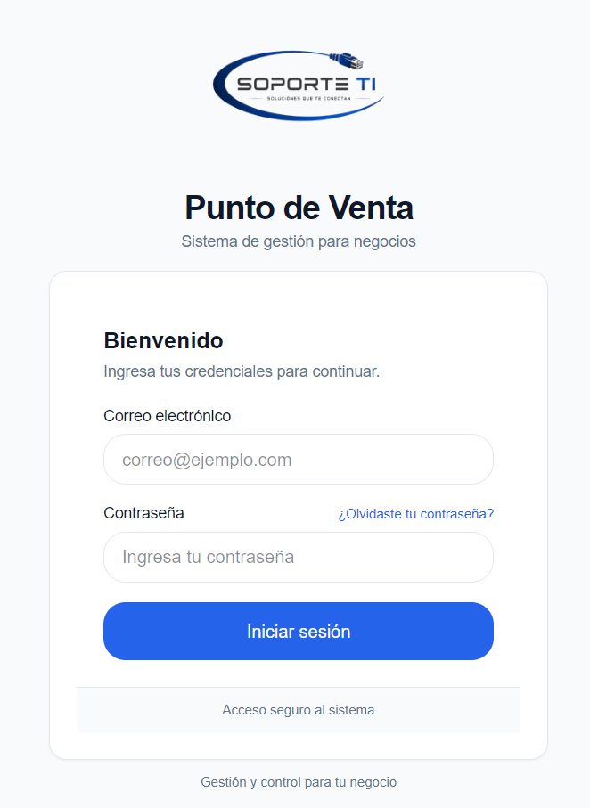
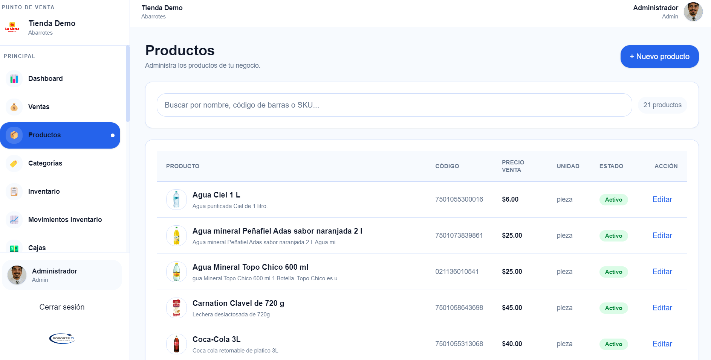
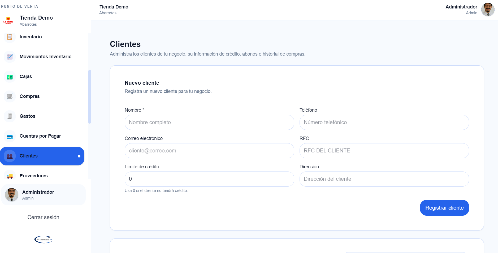
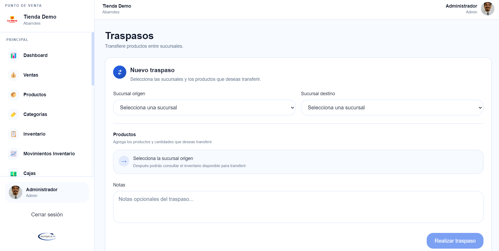
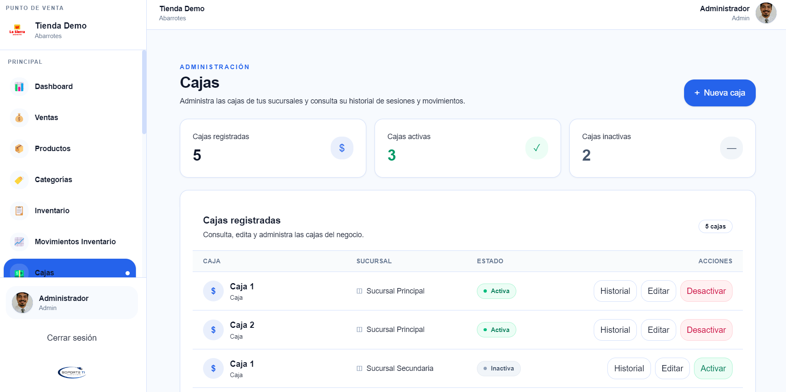
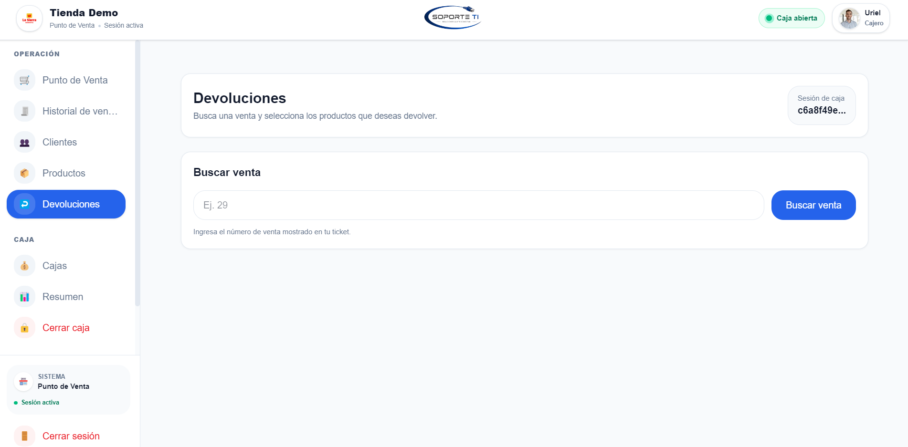
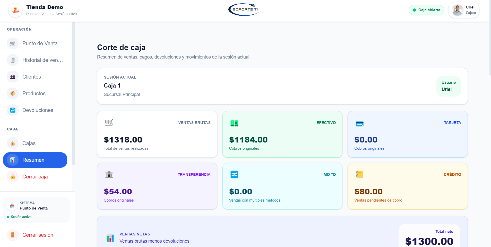

# 🛒 Sistema de Punto de Venta Multi-Negocios — Soporte IT

Sistema de punto de venta desarrollado para facilitar la administración y operación de negocios mediante herramientas de gestión comercial, control de inventario y seguimiento de operaciones.

La plataforma cuenta con un panel administrativo y un módulo de Punto de Venta (POS), con interfaces adaptables a diferentes dispositivos.

🌐 **Aplicación web:** https://punto-ventasit.vercel.app

## 🚀 Características principales

- Gestión de productos, categorías y proveedores.
- Registro y administración de ventas y compras.
- Control de inventario y movimientos de mercancía.
- Administración de clientes y ventas a crédito.
- Gestión de cajas y movimientos de efectivo.
- Administración de usuarios y roles.
- Control de sucursales y traspasos.
- Gestión de devoluciones y gastos.
- Configuración fiscal e impuestos.
- Consulta de reportes y cuentas por pagar.
- Configuración de impresoras para tickets de compra.
- Personalización de la apariencia del sistema.

## 🏗️ Arquitectura del sistema

El proyecto utiliza una arquitectura web basada en Next.js y Supabase, separando la interfaz de usuario de los servicios de autenticación y almacenamiento de información.

**Componentes principales:**

- **Frontend:** Next.js, React y TypeScript.
- **Backend y servicios:** Supabase.
- **Base de datos:** PostgreSQL.
- **Autenticación:** Supabase Auth.
- **Control de acceso:** Roles y permisos de usuario.
- **Despliegue:** Vercel.

El sistema está organizado en dos módulos principales:

- **Panel de Administración:** permite gestionar y supervisar las operaciones del negocio.
- **Punto de Venta (POS):** permite realizar ventas y administrar las operaciones cotidianas de caja.

La aplicación contempla la separación de información por negocio y el control de acceso a los datos mediante mecanismos de seguridad de Supabase.

## 🛠️ Tecnologías utilizadas

| Tecnología | Uso |
|---|---|
| Next.js 16 | Framework de desarrollo web |
| React 19 | Construcción de interfaces |
| TypeScript 5 | Tipado estático |
| JavaScript | Lógica de programación |
| Tailwind CSS 4 | Estilos e interfaz |
| Supabase | Servicios backend y autenticación |
| PostgreSQL | Base de datos relacional |
| ExcelJS | Manejo de archivos Excel |
| XLSX | Lectura y procesamiento de hojas de cálculo |
| Git y GitHub | Control de versiones |
| Vercel | Despliegue de la aplicación |

## 🎯 Objetivo del proyecto

Desarrollar una plataforma que permita administrar las principales operaciones de un negocio desde una interfaz intuitiva, adaptable y fácil de utilizar, integrando herramientas de gestión comercial, inventario, ventas y administración.

## 👨‍💻 Desarrollador

Proyecto desarrollado como iniciativa personal para aplicar y fortalecer conocimientos en desarrollo de software, diseño de interfaces, integración de servicios backend y gestión de bases de datos.

---

# 🔐 Accesos de demostración

La aplicación cuenta con dos módulos independientes:

### 🛡️ Panel de Administración

**URL:** https://punto-ventasit.vercel.app/admin/login

Permite explorar las herramientas de administración y configuración del negocio.

### 🛒 Punto de Venta (POS)

**URL:** https://punto-ventasit.vercel.app/pos/login

Permite explorar las funciones de venta, clientes, productos y operaciones de caja.

> **Nota:** Los accesos de demostración se pueden solicitar directamente al desarrollador. Se utilizan cuentas de prueba para evitar exponer credenciales en el repositorio público.

---

# 🖥️ Panel de Administración

El panel administrativo permite gestionar y supervisar las diferentes operaciones del negocio desde una plataforma centralizada.

## 🔐 Inicio de sesión

Acceso al módulo administrativo mediante autenticación de usuarios.

## 📊 Dashboard

Vista general del negocio con indicadores y estadísticas para facilitar el seguimiento de las operaciones.

## 📦 Gestión comercial

Administración del catálogo de productos, categorías, clientes y proveedores.

### Productos

### Categorías

### Clientes

### Proveedores

## 💰 Operaciones comerciales

Módulos para administrar las operaciones de venta, compras, devoluciones y gastos.

### Ventas

### Compras

### Devoluciones

### Gastos

## 📋 Control de inventario

Herramientas para consultar existencias, registrar movimientos y gestionar traspasos de mercancía.

### Inventario

### Movimientos de inventario

### Traspasos

## 🏢 Administración del negocio

Gestión de cajas, sucursales y usuarios del sistema.

### Cajas

### Sucursales

### Usuarios

## 📈 Finanzas y reportes

Consulta y seguimiento de información financiera y operativa.

### Cuentas por pagar

### Reportes

## ⚙️ Configuración del sistema

El sistema incluye opciones para adaptar diferentes parámetros de funcionamiento del negocio:

- Configuración fiscal e impuestos.
- Integración y configuración de terminales de Mercado Pago.
- Personalización de la apariencia e identidad visual del negocio.

---

# 🛒 Punto de Venta (POS)

Módulo diseñado para realizar las operaciones comerciales del negocio, permitiendo gestionar ventas, clientes, productos y movimientos de caja desde una interfaz intuitiva.

## 🔐 Inicio de sesión

Acceso independiente para los usuarios encargados de operar el punto de venta.

## 🛍️ Pantalla principal de ventas

Interfaz principal para realizar operaciones de venta, consultar productos y gestionar el proceso de compra.

## 📦 Productos

Consulta y selección de productos disponibles para realizar operaciones comerciales.

## 👥 Gestión de clientes y crédito

Permite registrar nuevos clientes del negocio y consultar su información.

El módulo contempla la gestión de clientes que pueden realizar compras mediante crédito, facilitando el seguimiento de sus operaciones.

## 🧾 Historial de ventas

Consulta de las ventas realizadas desde el punto de venta.

## 🔄 Devoluciones

Módulo para gestionar las devoluciones de productos.

## 💵 Gestión de caja

Herramientas para supervisar las operaciones y movimientos relacionados con la caja.

### Información y movimientos de caja

Consulta de los movimientos registrados durante la operación de caja.

### Resumen de caja

Consulta del resumen de las operaciones de caja.

### Cierre de caja

Interfaz para realizar el proceso de cierre de caja.

## ⚙️ Configuración del POS

El módulo cuenta con opciones para adaptar el funcionamiento y la apariencia de la interfaz.

Entre sus funcionalidades se encuentran:

- Configuración de impresoras para la impresión de tickets de compra.
- Personalización de la apariencia de la interfaz.
- Configuración de opciones del punto de venta.

---

# 🖥️ Versión de escritorio

Se contempla una versión de escritorio desarrollada con **Tauri**, actualmente en desarrollo.

---

# 📌 Estado del proyecto

La aplicación web se encuentra desplegada y disponible para demostración.

La versión de escritorio continúa en desarrollo.
