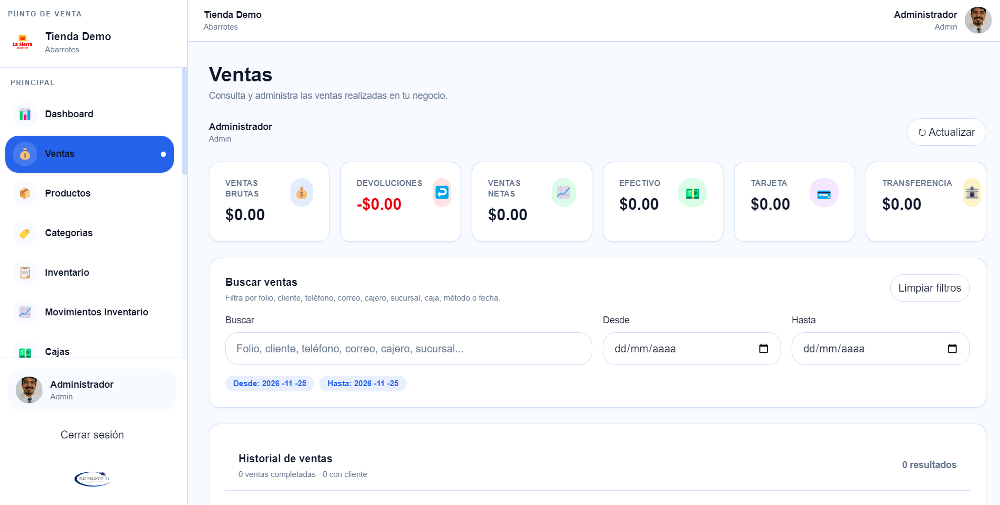
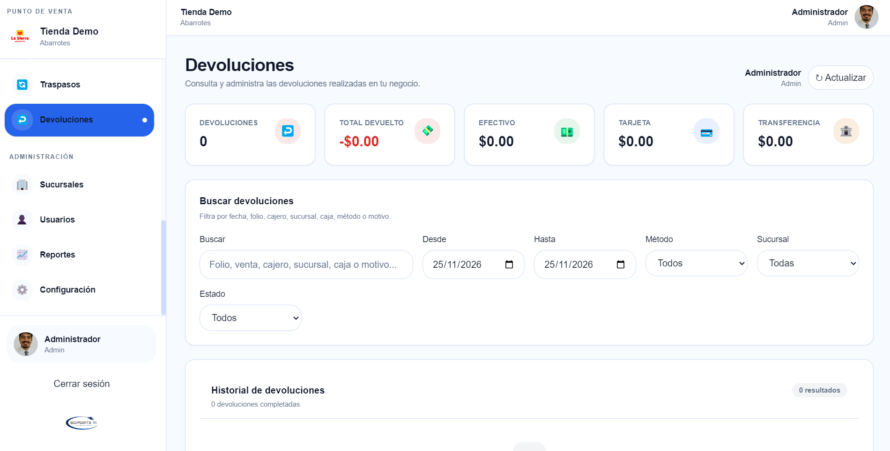
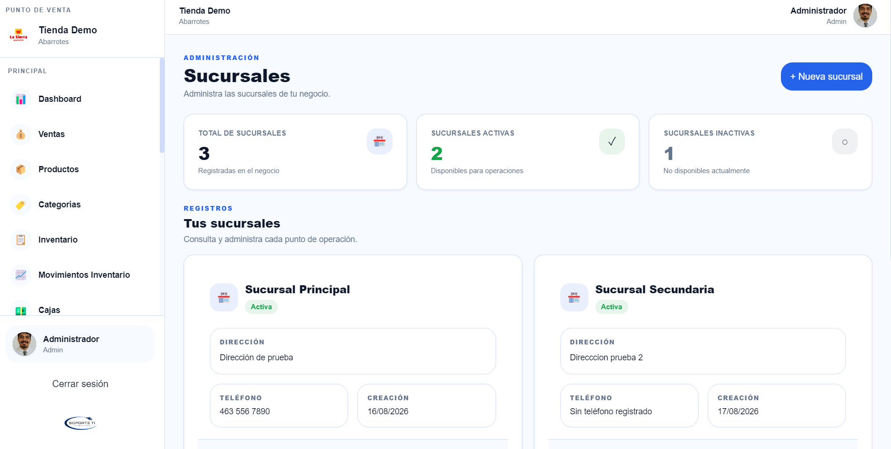
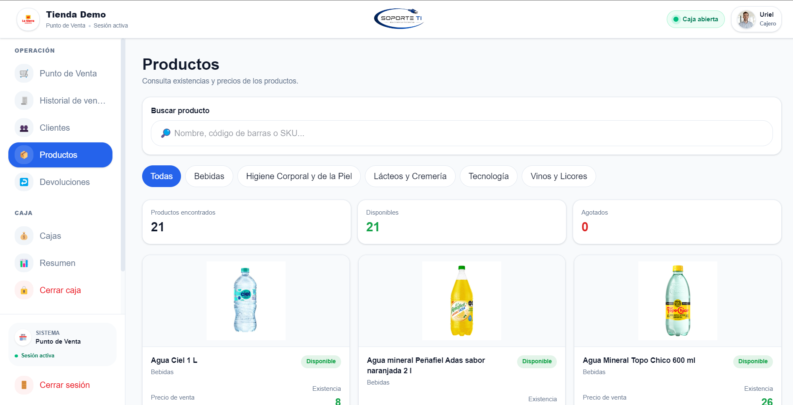
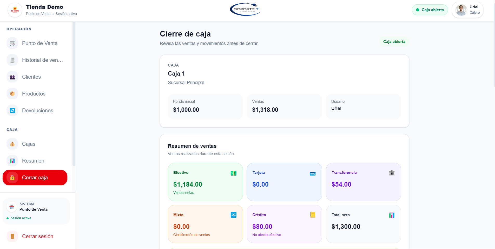

# 🛒 Sistema de Punto de Venta

Sistema de punto de venta desarrollado para facilitar la administración de negocios mediante herramientas de gestión comercial.

## 🚀 Características principales

- Gestión de productos y categorías.
- Registro y administración de ventas.
- Control de inventario.
- Administración de clientes.
- Gestión de cajas y movimientos.
- Administración de usuarios y roles.
- Control de sucursales.

## 🛠️ Tecnologías utilizadas

- Next.js
- React
- TypeScript
- JavaScript
- Supabase
- PostgreSQL
- Git y GitHub

## 🎯 Objetivo del proyecto

Desarrollar una plataforma que permita administrar las principales operaciones de un negocio desde una interfaz intuitiva, adaptable y fácil de utilizar.

## 👨‍💻 Desarrollador

Proyecto desarrollado como iniciativa personal para aplicar y fortalecer conocimientos en desarrollo de software.

## 🔐 Accesos de demostración

El sistema cuenta con dos módulos independientes, cada uno con su propio acceso:

### 🛡️ Panel de Administración

**URL:** https://punto-ventasit.vercel.app/admin/login

| Campo | Credencial |
|---|---|
| Correo | admin@tiendademo.com |
| Contraseña | Admin123 |

### 🛒 Punto de Venta (POS)

**URL:** https://punto-ventasit.vercel.app/pos/login

| Campo | Credencial |
|---|---|
| Correo | salaspatlandiego@gmail.com |
| Contraseña | Uriel123 |

> **Nota:** Estas credenciales son exclusivamente para fines de demostración y permiten explorar las funcionalidades del sistema.

# 🖥️ Panel de Administración

El panel administrativo permite gestionar y supervisar las diferentes operaciones del negocio desde una plataforma centralizada.

## 🔐 Inicio de sesión

Acceso seguro al módulo administrativo mediante autenticación de usuarios.

## 📊 Dashboard

Vista general del negocio con indicadores y estadísticas para facilitar el seguimiento de las operaciones.

## 📦 Gestión comercial

Administración del catálogo de productos, categorías, clientes y proveedores.

### Productos

### Categorías

### Clientes

### Proveedores

## 💰 Operaciones comerciales

Módulos para administrar las operaciones de venta, compras, devoluciones y gastos.

### Ventas

### Compras

### Devoluciones

### Gastos

## 📋 Control de inventario

Herramientas para consultar existencias, registrar movimientos y gestionar traspasos de mercancía.

### Inventario

### Movimientos de inventario

### Traspasos

## 🏢 Administración del negocio

Gestión de cajas, sucursales y usuarios del sistema.

### Cajas

### Sucursales

### Usuarios

## 📈 Finanzas y reportes

Consulta y seguimiento de información financiera y operativa.

### Cuentas por pagar

### Reportes

## ⚙️ Configuración del sistema

El sistema incluye opciones para adaptar diferentes parámetros de funcionamiento del negocio:

- Configuración fiscal e impuestos.
- Integración y configuración de terminales de Mercado Pago.
- Personalización de la apariencia del negocio.

# 🛒 Punto de Venta (POS)

Módulo diseñado para realizar las operaciones comerciales del negocio, permitiendo gestionar ventas, clientes, productos y movimientos de caja desde una interfaz intuitiva.

## 🔐 Inicio de sesión

Acceso independiente para los usuarios encargados de operar el punto de venta.

## 🛍️ Pantalla principal de ventas

Interfaz principal para realizar operaciones de venta, consultar productos y gestionar el proceso de compra.

## 📦 Productos

Consulta y selección de productos disponibles para realizar operaciones comerciales.

## 👥 Gestión de clientes y crédito

Permite registrar nuevos clientes del negocio y consultar su información.

El módulo contempla la gestión de clientes que pueden realizar compras mediante crédito, facilitando el seguimiento de sus operaciones.

## 🧾 Historial de ventas

Consulta de las ventas realizadas desde el punto de venta.

## 🔄 Devoluciones

Módulo para gestionar las devoluciones de productos.

## 💵 Gestión de caja

Herramientas para supervisar las operaciones y movimientos relacionados con la caja.

### Información y movimientos de caja

Consulta de los movimientos registrados durante la operación de caja.

### Resumen de caja

Consulta del resumen de las operaciones de caja.

### Cierre de caja

Interfaz para realizar el proceso de cierre de caja.

## ⚙️ Configuración del POS

El módulo cuenta con opciones para adaptar el funcionamiento y la apariencia de la interfaz.

Entre sus funcionalidades se encuentran:

- Configuración de impresoras para la impresión de tickets de compra.
- Personalización de la apariencia de la interfaz.
- Configuración de opciones del punto de venta.

